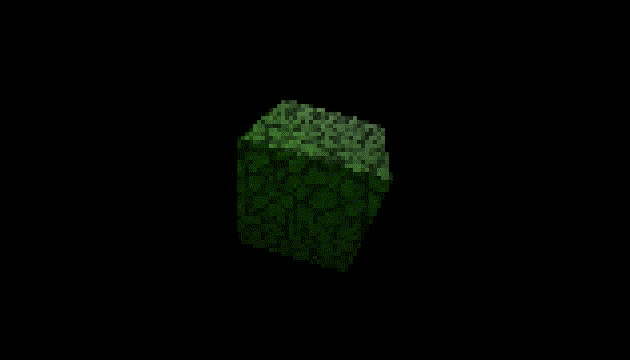

# alasgar
alasgar is a pure nim game engine based on OpenGL. The main reason to start developing a new game engine, was to learn graphics programming (first challenge) using nim programming language (second challenge). You can write the whole game logic and also shaders in nim. It supports a few platforms including mobile, web, and desktop. It performs well in the performance tests. It is the journey of a backend/system developer through graphics/game programming.

# Platforms
 - FreeBSD (tested on 14.0, probably works also on NetBSD and OpenBSD also)
 - Linux (tested on various distros like void and arch)
 - Windows (tested on Windows 11)
 - Android (tested on some old samsung devices)
 - WebAssembly (tested on firefox and chrome)
 - macOS (tested on macOS Ventura)
 - iOS (not supoorted)

## Experimental game engine
alasgar is a basic game engine, and it is limited, so it is not ready for production use.

## Moving from SDL to SOKOL
Compiling an extra dependency or distributing a dynamic library across platforms was a hassle,
especially on mobile and the web. The renderer depended on SDL only to create the OpenGL
context, so moving to SOKOL was straightforward. alasgar uses SOKOL only for windowing and
input management; it does not use SOKOL's graphics API.

Because alasgar's core is so minimal, switching to Vulkan or SOKOL's graphics API for rendering
would be straightforward. However, the decision was to stay with OpenGL, mainly to keep shader
handling simple and the engine minimal, without requiring external tools to precompile shaders.
For example, consider this program:
```nim
import alasgar

proc vs(IN_POSITION: Layout[0, Vec2], POSITION: var Vec2) =
  POSITION = IN_POSITION
  gl_Position = vec4(IN_POSITION, 0, 1)

proc fs(POSITION: Vec2, OUT_COLOR: var Layout[0, Vec4]) =
  let
    p = POSITION * vec2(GLSL_CAMERA.ASPECT, 1)
    pixel = 2.0 / GLSL_CAMERA.SCREEN_SIZE.y
    coverage = 1.0 - smoothstep(0.5 - pixel, 0.5 + pixel, length(p))
  OUT_COLOR = vec4(vec3(coverage), 1)

var
  circle: Pipeline
  camera: Camera

proc load() =
  circle = graphics.pipeline(
    graphics.shader(vs, fs),
    [vec2(-1, -1), vec2(3, -1), vec2(-1, 3)],
    [0'u16, 1, 2]
  )
  camera = graphics.perspective(vec3(0, 0, 1), vec3(0), 60, 0.1, 10)

proc draw() =
  graphics.render(circle, camera)

proc cleanup() =
  destroy(circle)

window(800, 600, "Shader Circle", load, draw, cleanup)
```
As you see this will render a white circle on the center of the screen. But to run this
small app, what you need is only:
```bash
nim c -r circle.nim
```
If there is an error in a shader, the Nim compiler reports it and stops compilation.
No middleware, no shader binaries, no bullshit—just pure Nim code. Until I find a seamless
way for developers (currently just me) to write everything in pure Nim and produce an
executable without external binaries, dependencies, or extra build steps, alasgar will
stay with OpenGL.

## Installation
```bash
nimble install https://github.com/abisxir/alasgar
```

## Quick start
```bash
git clone https://github.com/abisxir/alasgar.git
cd alasgar/examples
nim c -r text.nim
```

Table of Contents
=================

* [Window and scene creation](#window-and-scene-creation)  
* [Dependencies](#deps)

Window and scene creation
=========================
```nim
import alasgar

proc load() = discard
proc draw() = discard
proc cleanup() = discard

# Creates a window named Step 1
window(800, 600, "Step 1", load, draw, cleanup)
```

As you may familiar with the concept, we created a window and passed three functions.
The engine, will create a window and will call our functions in this order:

1. load: only once when window is created.
2. draw: on each frame, as long as game runs.
3. cleanup: when applications goes done, so will let the application to release the resources.

```bash
nim c -r main.nim
```

Check the [example](https://abisxir.github.io/alasgar/step1/build) here.

When you create a window by default it runs in window mode, you can easily enable fullscreen mode:
```nim
# Creates a window named Step1 and enables fullscreen mode.
window(800, 600, "Step1", load, draw, cleanup, fullscreen=true)
```

Dependencies
============
## sokol
The engine relies on [sokol](https://github.com/floooh/sokol-nim) for window creation and input handling but does not use anything further. When the window is created, it creates the OpenGL context and works directly on top of OpenGL, not sokol functions and paradigms for rendering.
